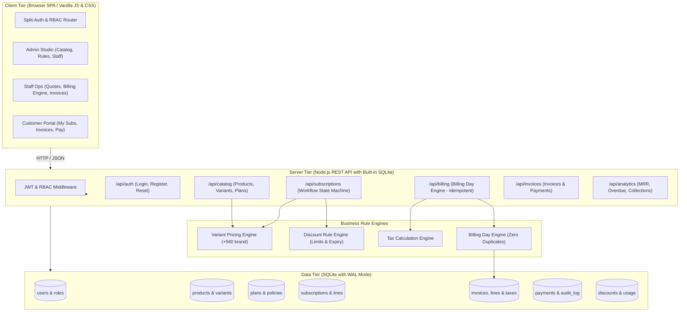

# Brightloop Subscription Management System — Architectural Blueprint & Master Plan

> **Event:** Odoo × FLUX Hackathon 2026  
> **Challenge:** Subscription Management System for Brightloop Software  
> **Target:** 100% Problem Statement Coverage, Production-Grade Architecture, Offline Local Database, Sub-2s SLA  

---

## 1. Hackathon Reality Check: Where the Team Stands

### 1.1 The Good
- **Visuals & Branding:** The Odoo purple (`#714b67`) and teal (`#008784`) split-screen aesthetic is visually aligned with Odoo's design language.
- **Role Presets:** The 1-click test accounts (Admin, Staff, Customer) provide judges with quick, low-friction evaluation.
- **Workflow Diagrams:** High-level SVGs for billing, onboarding, and architecture already exist in `diagrams/`.
- **Password Security:** Scrypt hashing and password validation policy are implemented in `services/authService.js`.

### 1.2 Critical Gaps According to the Judging Criteria

| Judging Requirement | Current Status | Risk Level | Remedy |
| :--- | :--- | :--- | :--- |
| **Dynamic Data Source** (*"Avoid static JSON beyond early prototyping"*) | Pure client-side `localStorage` mock | 🔴 **High Risk** | Implement a local backend API backed by embedded SQLite (`node:sqlite`) with WAL mode. |
| **Billing Day Engine** (*"Nothing billed twice or skipped"*) | Missing automated generation engine | 🔴 **High Risk** | Build an idempotent Billing Engine service with `next_billing_date` and duplicate prevention constraints. |
| **Variant Pricing (+560 Odoo)** | Hardcoded in mock string | 🟡 **Medium Risk** | Implement dynamic product variant surcharge calculations in the database & order lines. |
| **Discount Engine** | Not implemented | 🟡 **Medium Risk** | Implement discount rules with fixed/percentage calculations, usage count limits, and expiry dates. |
| **Invoice & Payment Flow** | Read-only static table | 🟡 **Medium Risk** | Add invoice state machine (`Draft` → `Confirmed` → `Paid`), printable invoice view, and payment recording. |
| **Sub-2s Query SLA** | Static view | 🟢 **Easy Win** | SQLite indexes on `status`, `customer_id`, and `next_billing_date` achieve `< 20ms` query times. |
| **Git Distribution across 4 Members** | Commits currently concentrated | 🟡 **Medium Risk** | Divide the project into 4 distinct feature modules for concurrent commits. |

---

## 2. System Architecture & End-to-End Data Flow



---

## 3. Relational Database Schema (SQLite)

```sql
-- 1. Users & RBAC
CREATE TABLE IF NOT EXISTS users (
  id TEXT PRIMARY KEY,
  name TEXT NOT NULL,
  email TEXT UNIQUE NOT NULL,
  password_hash TEXT NOT NULL,
  role TEXT CHECK(role IN ('admin', 'staff', 'customer')) NOT NULL,
  created_at DATETIME DEFAULT CURRENT_TIMESTAMP
);

-- 2. Products & Variants (e.g. Odoo brand +$560)
CREATE TABLE IF NOT EXISTS products (
  id TEXT PRIMARY KEY,
  name TEXT NOT NULL,
  product_type TEXT DEFAULT 'service',
  cost_price REAL NOT NULL,
  sales_price REAL NOT NULL,
  notes TEXT
);

CREATE TABLE IF NOT EXISTS product_variants (
  id TEXT PRIMARY KEY,
  product_id TEXT NOT NULL,
  variant_name TEXT NOT NULL, -- e.g. "Brand: Odoo"
  price_extra REAL NOT NULL DEFAULT 0.0, -- e.g. 560.0
  FOREIGN KEY(product_id) REFERENCES products(id) ON DELETE CASCADE
);

-- 3. Subscription Plans & Lifecycles
CREATE TABLE IF NOT EXISTS plans (
  id TEXT PRIMARY KEY,
  name TEXT NOT NULL,
  billing_frequency TEXT CHECK(billing_frequency IN ('daily', 'weekly', 'monthly', 'yearly')) NOT NULL,
  price REAL NOT NULL,
  min_quantity INTEGER DEFAULT 1,
  start_date DATE,
  end_date DATE,
  auto_close_on_expiry INTEGER DEFAULT 1,
  can_pause INTEGER DEFAULT 1,
  can_renew INTEGER DEFAULT 1
);

-- 4. Quotation Templates
CREATE TABLE IF NOT EXISTS quotation_templates (
  id TEXT PRIMARY KEY,
  name TEXT NOT NULL,
  plan_id TEXT NOT NULL,
  validity_days INTEGER DEFAULT 30,
  FOREIGN KEY(plan_id) REFERENCES plans(id)
);

-- 5. Subscriptions (Workflow State Machine)
CREATE TABLE IF NOT EXISTS subscriptions (
  id TEXT PRIMARY KEY,
  sub_number TEXT UNIQUE NOT NULL, -- e.g. SUB-2026-0001
  customer_id TEXT NOT NULL,
  plan_id TEXT NOT NULL,
  status TEXT CHECK(status IN ('draft', 'quotation', 'confirmed', 'active', 'paused', 'closed')) DEFAULT 'draft',
  start_date DATE NOT NULL,
  expiry_date DATE,
  next_billing_date DATE NOT NULL,
  payment_terms TEXT DEFAULT 'Immediate Payment',
  discount_id TEXT,
  total_recurring_amount REAL NOT NULL,
  FOREIGN KEY(customer_id) REFERENCES users(id),
  FOREIGN KEY(plan_id) REFERENCES plans(id)
);

CREATE TABLE IF NOT EXISTS subscription_lines (
  id TEXT PRIMARY KEY,
  subscription_id TEXT NOT NULL,
  product_id TEXT NOT NULL,
  variant_id TEXT,
  quantity INTEGER NOT NULL DEFAULT 1,
  unit_price REAL NOT NULL,
  tax_rate REAL DEFAULT 0.18, -- 18% standard GST/VAT
  subtotal REAL NOT NULL,
  FOREIGN KEY(subscription_id) REFERENCES subscriptions(id) ON DELETE CASCADE
);

-- 6. Discounts Rules
CREATE TABLE IF NOT EXISTS discount_rules (
  id TEXT PRIMARY KEY,
  code TEXT UNIQUE NOT NULL,
  discount_type TEXT CHECK(discount_type IN ('fixed', 'percentage')) NOT NULL,
  value REAL NOT NULL, -- e.g. 10 ($10 or 10%)
  min_quantity INTEGER DEFAULT 1,
  min_purchase REAL DEFAULT 0.0,
  start_date DATE,
  end_date DATE,
  usage_limit INTEGER DEFAULT 100,
  times_used INTEGER DEFAULT 0,
  applied_to TEXT CHECK(applied_to IN ('all', 'product')) DEFAULT 'all',
  target_product_id TEXT
);

-- 7. Invoices (Automated Billing Day Engine Output)
CREATE TABLE IF NOT EXISTS invoices (
  id TEXT PRIMARY KEY,
  invoice_number TEXT UNIQUE NOT NULL, -- e.g. INV-2026-0001
  subscription_id TEXT NOT NULL,
  customer_id TEXT NOT NULL,
  status TEXT CHECK(status IN ('draft', 'confirmed', 'paid', 'cancelled')) DEFAULT 'draft',
  billing_date DATE NOT NULL,
  due_date DATE NOT NULL,
  subtotal REAL NOT NULL,
  tax_amount REAL NOT NULL,
  discount_amount REAL NOT NULL DEFAULT 0.0,
  total_amount REAL NOT NULL,
  idempotency_key TEXT UNIQUE NOT NULL, -- Prevents duplicate billing: "subId_YYYY-MM-DD"
  FOREIGN KEY(subscription_id) REFERENCES subscriptions(id),
  FOREIGN KEY(customer_id) REFERENCES users(id)
);

-- 8. Payments
CREATE TABLE IF NOT EXISTS payments (
  id TEXT PRIMARY KEY,
  invoice_id TEXT NOT NULL,
  payment_method TEXT CHECK(payment_method IN ('card', 'bank_transfer', 'upi', 'cash', 'check')) NOT NULL,
  amount REAL NOT NULL,
  payment_date DATE NOT NULL,
  reference_notes TEXT,
  recorded_by TEXT NOT NULL,
  FOREIGN KEY(invoice_id) REFERENCES invoices(id)
);

-- Performance Indexes (< 2s SLA Guarantee)
CREATE INDEX IF NOT EXISTS idx_subs_status ON subscriptions(status);
CREATE INDEX IF NOT EXISTS idx_subs_billing ON subscriptions(next_billing_date);
CREATE INDEX IF NOT EXISTS idx_inv_status ON invoices(status);
CREATE INDEX IF NOT EXISTS idx_inv_dates ON invoices(due_date, billing_date);
```

---

## 4. End-to-End Business Logic Engines

### Engine 1: Product Variant Pricing
$$\text{Line Unit Price} = \text{Product Base Sales Price} + \text{Variant Price Surcharge}$$
Example: Base Software (\$100) + Odoo Brand Variant (\$560) = \$660 per unit.

### Engine 2: Billing Day Engine (Zero Duplication & Idempotent)
1. Query active subscriptions where `next_billing_date <= CURRENT_DATE`.
2. Construct `idempotency_key = sub.id + '_' + sub.next_billing_date`.
3. Wrap in atomic transaction:
   - Verify no invoice exists with that key.
   - Insert new invoice in `draft` status with calculated lines, active discount rules, and tax.
   - Advance `next_billing_date` based on plan frequency (daily = +1d, weekly = +7d, monthly = +1m, yearly = +1y).
   - If `auto_close_on_expiry = 1` and `next_billing_date > expiry_date`, transition subscription to `closed`.

### Engine 3: Discount Engine
1. Check date window: `start_date <= today <= end_date`.
2. Check usage count: `times_used < usage_limit`.
3. Check minimum purchase/seat quantity.
4. Auto-apply to line items or entire subscription; increment `times_used`.

### Engine 4: Real-time Finance Analytics (< 2s SLA)
- **Monthly Recurring Revenue (MRR):**
  $$\text{MRR} = \sum_{\text{monthly}} \text{Amount} + \sum_{\text{yearly}} \frac{\text{Amount}}{12} + \sum_{\text{weekly}} (\text{Amount} \times 4.33)$$
- **Cash Collections:** Sum of payments in the current month.
- **Overdue Invoices:** Confirmed invoices past `due_date`.

---

## 5. 4-Member Hackathon Team Work Breakdown

```
├── Teammate 1 (Backend & DB Core)
│   ├── sqlite.js (schema setup, migrations, seed data with node:sqlite)
│   ├── authController.js (login, register, reset token)
│   └── catalogController.js (products, variants, plans, templates)
│
├── Teammate 2 (Engines & Business Logic)
│   ├── billingEngine.js (recurring invoice generation, idempotency)
│   ├── discountEngine.js (rules, validation, usage limits)
│   └── invoiceController.js (transitions: draft -> confirmed -> paid)
│
├── Teammate 3 (Frontend & Workflow UI)
│   ├── quotationBuilder.js (quote-to-subscription lifecycle view)
│   ├── subscriptionManager.js (pause, renew, close actions)
│   └── customerPortal.js (customer-facing self-service)
│
└── Teammate 4 (Finance Lead Analytics, Invoice Print/PDF & Docs)
    ├── analyticsController.js (MRR, overdue aging, collection stats)
    ├── invoicePrintView.js (printable invoice view)
    └── README.md & Demo Script (recordings, screenshots, architecture)
```

